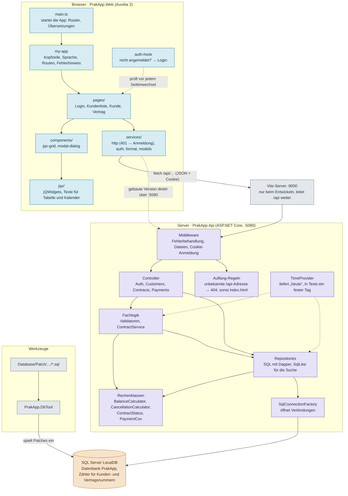
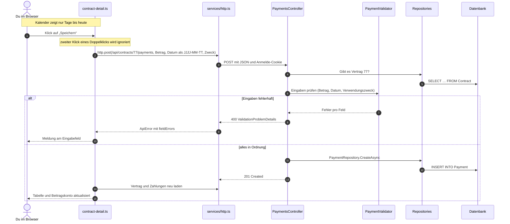
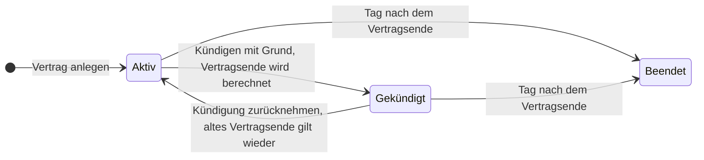
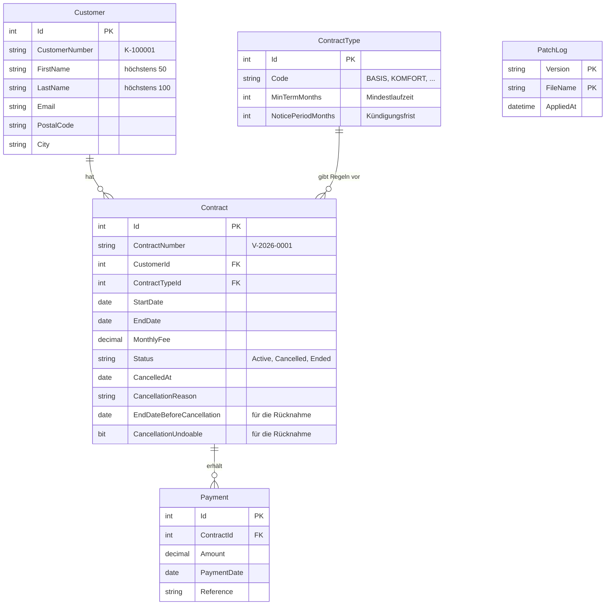

Praktikum · Vertragsverwaltung

# prak-app Architektur

Wie die Teile der App zusammenhängen: vom Klick im Browser über die REST-API bis in die Datenbank. Alles hier stammt direkt aus dem Code, Stand 30.10.2026. Was seit der ersten Fassung vom 22.10.2026 dazugekommen ist, trägt die Markierung *(neu)*.

**Inhalt:** [Überblick](#überblick) · [Seit dem 22.10.](#was-seit-dem-2210-dazugekommen-ist) · [Das große Bild](#das-große-bild) · [Ablauf einer Anfrage](#ablauf-einer-anfrage-zahlung-erfassen) · [Lebenslauf eines Vertrags](#lebenslauf-eines-vertrags) · [Backend](#backend-srcprakappapi) · [Frontend](#frontend-srcprakappweb) · [Datenbank](#datenbank) · [Werkzeuge & Tests](#werkzeuge--tests) · [Begriffe](#begriffe-kurz-erklärt)

## Überblick

Die App verwaltet Kunden, Verträge und Zahlungen der fiktiven „Lindenau Tarifservice GmbH“. Sie besteht aus drei großen Teilen, die über klar getrennte Schnittstellen miteinander reden.

- **Frontend:** Aurelia 2 + TypeScript – läuft im Browser · `src/PrakApp.Web`
- **Backend:** ASP.NET Core (.NET 9) – REST-API · `src/PrakApp.Api`
- **Datenbank:** SQL Server LocalDB – Datenbank `PrakApp`
- **Adressen:** Port 5080 und 9000 – 5080 = Backend, 9000 = Vite beim Entwickeln
- **Tests:** 163 + 45 – Backend (xUnit) und Browser (Playwright)

## Was seit dem 22.10. dazugekommen ist

Die erste Fassung dieser Seite entstand am ersten Praktikumstag. Seitdem wurden Fehler behoben, Funktionen ergänzt und fehlende Tests geschrieben. Jede Änderung wurde zuerst mit einem Test nachgestellt, der rot war, dann korrigiert und erneut getestet.

### Neue Funktionen

- Kündigung mit Berechnung und Vorschau
- Kündigung zurücknehmen
- Status „Beendet“ nach Vertragsende
- Suche nach Vertragsnummer
- Hinweis „Zahlungserinnerung fällig“
- Warnung vor doppelten Kunden
- Kunden ohne Verträge löschen
- CSV-Export der Zahlungen
- Keine Zahlungen in der Zukunft

### Behobene Fehler

- Zahlungsdatum wurde einen Tag zu früh gespeichert
- Spalte „Verträge“ zählte Zahlungen statt Verträge
- Fehler 500 bei zu langen Namen und Feldern
- „Abbrechen“ ließ Änderungen beim Bearbeiten stehen
- Doppelklick auf „Speichern“ legte Daten doppelt an
- Doppelklick beim Bearbeiten und Kündigen sendete doppelt
- Zweistelliges Jahr und Backspace (Jahr 1900) im Datum
- Suche reagierte nicht auf X und Einfügen, fand keinen Ort
- Suche mit % oder _ fand alle Kunden
- Abgelaufene Sitzung führte nicht zur Anmeldung
- „Angelegt am“ zeigte nachts den Vortag
- Links in der Pfadzeile führten zu einem Fehler
- Unbekannte API-Adressen lieferten die Startseite statt 404
- Deutsch und Englisch in der Oberfläche gemischt
- Kalender-Pfeile zeigten den Tooltip „undefined“
- Beitragskonto zählte einen Monat zu wenig
- Gleichzeitiges Anlegen ergab doppelte Nummern
- Fehlermeldungen schnitten Knöpfe im Dialog ab

### Tests

- Backend: von 23 auf 163 Tests in 22 Dateien
- Browser: von 5 auf 45 Playwright-Tests in 13 Dateien
- Testabdeckung gemessen, 7 fehlende Tests ergänzt, darunter ein Test für das DbTool
- Jeder neue Test mit Gegenprobe: absichtlicher Fehler im Code, Test wird rot

## Das große Bild

Jeder Pfeil zeigt, wer wen benutzt. Wichtig ist die Richtung: Ein Controller kennt die Repositories, aber ein Repository weiß nichts von Controllern. So bleibt jede Schicht für sich verständlich und testbar.

Legende: Frontend (Browser) · Backend (Server) · Datenbank · Werkzeuge

*Beim Entwickeln (F5) öffnest du `http://localhost:9000`. Vite liefert dann die Frontend-Dateien und reicht alle `/api`-Aufrufe an das Backend weiter. Nach `pnpm build` liegt das fertige Frontend in `src/PrakApp.Api/wwwroot`, dann liefert das Backend alles selbst über Port 5080 aus.*

## Ablauf einer Anfrage: „Zahlung erfassen“

Am besten versteht man die Schichten, wenn man eine echte Aktion durch das System verfolgt. So läuft es ab, wenn du auf der Vertragsseite eine Zahlung speicherst:

Daran sieht man die Aufgaben der Schichten: Die **Seite** sammelt die Eingaben, **http.ts** verschickt sie, der **Controller** entscheidet über den HTTP-Statuscode, der **Validator** prüft die Regeln und das **Repository** schreibt in die Datenbank. Fehler 400 (falsche Eingabe) landen freundlich am Eingabefeld. Antwortet der Server mit 401, ist die Sitzung abgelaufen, und die App wechselt zur Anmeldung. Alles andere, was niemand abfängt, erscheint oben als roter Hinweis „Unerwarteter Fehler“.

Die Prüfung im Server bleibt nötig, obwohl der Kalender keine Tage in der Zukunft anbietet: Wer die API direkt aufruft, umgeht die Oberfläche.

## Lebenslauf eines Vertrags

*(neu)* Ein Vertrag hat drei Zustände. „Beendet“ wird nicht gespeichert, sondern beim Lesen aus dem Vertragsende berechnet (`ContractStatus.Effective`). So stimmt der Status jeden Tag, ohne dass ein Programm nachts die Datenbank aktualisieren muss.

*Vertragsende beim Kündigen: Ende des Monats, in dem die Kündigungsfrist abläuft, frühestens nach der Mindestlaufzeit, nie vor dem Vertragsbeginn. Ein früheres vorhandenes Ende bleibt. Regeln im Detail: `docs/features/kuendigung.md`.*

## Backend: `src/PrakApp.Api`

Die Dateien sind nach **Fachthema** gruppiert, nicht nach Technik. Alles rund um Kunden liegt in `Customers/`, egal ob Controller, Validator oder Repository. Fast jede Fachthemen-Mappe enthält dieselben Bausteine:

| Baustein | Aufgabe | Beispiel |
|---|---|---|
| Controller | nimmt HTTP-Anfragen an, ruft die richtigen Klassen auf, gibt Statuscodes zurück (200, 201, 204, 400, 404, 409) | `CustomersController` |
| Models | `record`-Typen: wie die Daten aussehen (Ein- und Ausgabe) | `CustomerInput`, `Customer` |
| Validator | prüft Eingaben und sammelt Fehlermeldungen pro Feld | `CustomerValidator` |
| Repository | enthält das SQL und übersetzt Tabellenzeilen in C#-Objekte (mit Dapper) | `CustomerRepository` |
| Service | Fachlogik, die mehrere Repositories braucht (gibt es nur bei Verträgen) | `ContractService` |
| Rechenklasse *(neu)* | reine Rechnung ohne Datenbank, deshalb einfach mit Unit-Tests zu prüfen | `CancellationCalculator` |

#### `Program.cs`

Der Startpunkt. Hier wird alles „verdrahtet“: Anmeldung per Cookie, die Middleware-Reihenfolge und die Registrierung aller Klassen für Dependency Injection.

- Die Controller verlangen Anmeldung (`RequireAuthorization`)
- `/health` antwortet ohne Anmeldung
- Unbekannte `/api`-Adressen → 404 *(neu)*
- Alle anderen unbekannten Adressen → `index.html` (damit Links wie `/customers/12` funktionieren)

#### `Auth/`

Demo-Anmeldung ohne Passwort. Man wählt einen Benutzer aus der Liste in `appsettings.json` und bekommt ein Cookie `prakapp.auth`, gültig 8 Stunden nach der letzten Aktivität.

- `AuthController`: users, login, logout, me
- `DemoUser.cs`: Einstellungen für die Benutzerliste

#### `Customers/`

Kunden suchen, anzeigen, anlegen, ändern und löschen. Die Kundennummer `K-…` kommt aus einem Zähler in der Datenbank.

- Suche nach Name, Ort (Anfang) und Kundennummer
- Doppelte Kunden finden *(neu)*
- Löschen nur ohne Verträge *(neu)*
- Pflicht: Vor- und Nachname; PLZ fünfstellig, E-Mail-Format, Höchstlängen wie in der Datenbank

#### `Contracts/`

Verträge, Tarife und das Beitragskonto. Der umfangreichste Bereich, weil hier die meiste Fachlogik steckt.

- `ContractService`: anlegen, Details, kündigen, Vorschau, zurücknehmen *(neu)*
- `CancellationCalculator`: Vertragsende beim Kündigen *(neu)*
- `BalanceCalculator`: fällige Monate, Soll, Saldo, Zahlungserinnerung
- `ContractStatus.Effective`: „Beendet“ nach dem Vertragsende *(neu)*
- Suche nach Vertragsnummer, höchstens 10 Treffer *(neu)*

#### `Payments/`

Zahlungen zu einem Vertrag anzeigen, erfassen und exportieren. Die Adresse hängt am Vertrag: `/api/contracts/{id}/payments`.

- Betrag über 0 bis 99.999,99, Datum ab 01.01.2000 und nicht in der Zukunft, Verwendungszweck höchstens 100 Zeichen
- `PaymentCsv`: CSV für ein deutsches Excel, schützt vor Formeln im Text *(neu)*

#### `Common/` · `Data/`

Gemeinsame Helfer. `ValidationErrors` sammelt Fehler pro Feld, `CurrentUser` liest den angemeldeten Benutzernamen. `SqlConnectionFactory` erzeugt Datenbankverbindungen aus dem Connection String. `SqlLike` sorgt dafür, dass %, _ und [ in der Suche als normale Zeichen gelten *(neu)*.

### Wer lebt wie lange? (Dependency Injection in `Program.cs`)

| Lebensdauer | Bedeutung | Klassen |
|---|---|---|
| `Singleton` | genau ein Objekt für die ganze Laufzeit | `TimeProvider`, `SqlConnectionFactory`, alle Validatoren (auch `CancellationValidator`), `BalanceCalculator` |
| `Scoped` | ein neues Objekt pro HTTP-Anfrage | alle Repositories, `ContractService` |
| nicht registriert | statische Klassen, die man direkt aufruft | `CancellationCalculator`, `ContractStatus`, `PaymentCsv`, `SqlLike` |

`TimeProvider` ist ein kleiner Trick für Tests: Statt direkt „jetzt“ abzufragen, fragt der Code den TimeProvider. In einem Test kann man ihm ein festes Datum geben, siehe `BalanceCalculatorTests` und `ContractServiceCancelTests`.

### Alle Endpunkte (so wie sie im Code stehen)

| Methode | Pfad | Was passiert | Antworten |
|---|---|---|---|
| GET | `/api/auth/users` | Liste der Demo-Benutzer (ohne Anmeldung) | 200 |
| POST | `/api/auth/login` · `/logout` | Anmelden / Abmelden | 200 401 / 204 |
| GET | `/api/auth/me` | Wer ist angemeldet? | 200 401 |
| GET | `/api/customers?q=…` | Kunden suchen (ohne `q`: alle) | 200 |
| GET | `/api/customers/duplicates` *(neu)* | Kunden mit gleichem Namen und gleicher PLZ | 200 |
| GET · PUT | `/api/customers/{id}` | Kunde lesen / ändern | 200 400 404 |
| DELETE | `/api/customers/{id}` *(neu)* | Kunde ohne Verträge löschen | 204 404 409 |
| POST | `/api/customers` | Kunde anlegen | 201 400 |
| GET | `/api/customers/{id}/contracts` | Verträge eines Kunden, mit Zahlungserinnerung | 200 404 |
| GET | `/api/contract-types` | Tarife | 200 |
| GET | `/api/contracts?q=…` *(neu)* | Verträge nach Nummer suchen | 200 |
| GET | `/api/contracts/{id}` | Vertrag mit Beitragskonto | 200 404 |
| POST | `/api/contracts` | Vertrag anlegen | 201 400 |
| GET | `/api/contracts/{id}/cancellation-preview` *(neu)* | Vertragsende bei Kündigung heute (speichert nichts) | 200 404 409 |
| POST | `/api/contracts/{id}/cancel` | Vertrag kündigen (jetzt fertig umgesetzt) | 204 400 404 409 |
| POST | `/api/contracts/{id}/undo-cancellation` *(neu)* | Kündigung zurücknehmen | 204 404 409 |
| GET · POST | `/api/contracts/{id}/payments` | Zahlungen lesen / erfassen | 200 201 400 404 |
| GET | `/api/contracts/{id}/payments/export` *(neu)* | Zahlungen als CSV-Datei | 200 404 |
| GET | `/health` | Lebenszeichen für Start-Skripte und Playwright | 200 |

## Frontend: `src/PrakApp.Web`

Eine Single-Page-App: Der Browser lädt einmal `index.html`, danach tauscht Aurelia nur noch den Inhalt aus. Zu jeder `.ts`-Datei (Logik) gehört eine gleichnamige `.html`-Datei (Aussehen). Beide verbindet Aurelia über **Bindings** wie `value.bind` oder `click.trigger`.

#### `src/main.ts`

Startet Aurelia, richtet Router und Übersetzungen ein und meldet globale Bausteine an, die überall ohne Import nutzbar sind (Grid, Dialog, Kundenformular, Auth-Hook).

#### `src/my-app.*`

Der Rahmen um jede Seite: Kopfzeile, Sprachauswahl, Abmelden, roter Fehlerhinweis. Hier stehen auch die **Routen** und die übersetzten Tab-Titel.

- `login`, `customers`, `customers/:id`, `contracts/:id`
- Bei 401 (Sitzung abgelaufen) zur Anmeldung *(neu)*

#### `src/auth-hook.ts`

Läuft vor jedem Seitenwechsel. Ist niemand angemeldet, geht es zur Anmeldeseite. Nur die Login-Route ist als öffentlich markiert.

#### `src/pages/`

Die Seiten, die man sieht. Jede lädt ihre Daten in `loading()`, bevor sie angezeigt wird. Alle Dialoge sind gegen Doppelklick geschützt.

- `login/`: Benutzer auswählen
- `customers/`: Liste mit Suche und Vertragstreffern, Warnung vor doppelten Kunden, Detailseite mit Bearbeiten, Löschen und neuem Vertrag
- `contracts/`: Vertragsdetails, Zahlung erfassen, Kündigen, Kündigung zurücknehmen, CSV-Export

#### `src/components/`

Dünne Hüllen um jQWidgets, damit man sie wie normale Aurelia-Bausteine benutzen kann.

- `jqx-grid`: Tabelle mit Sortieren und Seiten
- `modal-dialog`: Dialogfenster, Inhalt per `<au-slot>`

#### `src/services/`

Alles ohne eigene Oberfläche.

- `http.ts`: `fetch`-Hülle mit get, post, put und delete, macht aus Fehlern ein `ApiError`
- `auth.ts`: hält den angemeldeten Benutzer (Singleton)
- `format.ts`: Geld und Datum formatieren, `toIsoDate` ohne UTC-Umrechnung *(neu)*
- `models.ts`: TypeScript-Typen passend zur API

#### `src/jqx/`

Lädt jQuery und die jQWidgets-Module in der richtigen Reihenfolge. jQWidgets erwartet jQuery als globale Variable, deshalb kommt `jquery-global.ts` zuerst. `localization.ts` liefert Tabelle und Kalender die deutschen oder englischen Texte *(neu)*.

#### `src/locales/`

Alle Texte der Oberfläche auf Deutsch (`de.json`) und Englisch (`en.json`), je 96 Schlüssel. Im HTML stehen nur Schlüssel wie `t="customers.title"`.

## Datenbank

Vier Fachtabellen und eine Verwaltungstabelle. Die Linien zeigen die Beziehungen: Ein Kunde kann viele Verträge haben, ein Vertrag viele Zahlungen, und jeder Vertrag gehört zu genau einem Tarif.

*Vereinfacht: Es sind nicht alle Spalten gezeigt. Die vollständigen Definitionen stehen in den Patch-Skripten. Dazu kommen zwei Zähler (`SEQUENCE`) für die Kunden- und Vertragsnummern.*

### Wie das Schema entsteht: Patch-Skripte

Es gibt keine Datei „so sieht die Datenbank aus“. Stattdessen gibt es eine Reihe nummerierter Änderungen unter `Database/Patch/<Version>/Approved/core/`, die nacheinander eingespielt werden:

1. `1.0.0/0001` bis `0004`: Tabellen anlegen
2. `1.0.0/0005`: die vier Tarife eintragen
3. `1.0.0/0006`: erfundene Demo-Daten (64 Kunden, 77 Verträge, 1.556 Zahlungen)
4. `1.1.0/0001`: Spalten für die Kündigung ergänzen
5. `1.1.0/0002`: Nachname von 80 auf 100 Zeichen *(neu)*
6. `1.1.0/0003`: Zähler für Kunden- und Vertragsnummern, damit gleichzeitiges Anlegen keine doppelten Nummern ergibt *(neu)*
7. `1.1.0/0004`: Spalten, mit denen sich eine Kündigung zurücknehmen lässt *(neu)*

Die Tabelle `PatchLog` merkt sich, was schon eingespielt ist. Deshalb gilt: **Ein eingespieltes Skript wird nie mehr geändert.** Jede neue Änderung bekommt ein neues Skript mit der nächsten Nummer.

## Werkzeuge & Tests

#### `tools/PrakApp.DbTool`

Kleines Kommandozeilen-Programm, das die Patch-Skripte einspielt. `rebuild` löscht die Datenbank und baut sie neu auf, `update` spielt nur fehlende Patches ein. Reihenfolge nach Version als Zahl (1.10.0 nach 1.9.0), dann nach Dateiname.

#### `Database/rebuild-database.ps1`

Startet LocalDB und ruft das DbTool mit `rebuild` auf. Auch in VS Code als Aufgabe „db: rebuild“ verfügbar.

#### `tests/PrakApp.Api.Tests`

163 xUnit-Tests für das Backend, Start mit `dotnet test`.

- Unit-Tests: Validatoren, Rechenklassen, Vertragsstatus, CSV
- Service-Tests mit Fake-Repository statt Datenbank *(neu)*
- Endpunkt-Tests: API im Speicher, mit der Datenbank PrakApp, nur lesend *(neu)*
- DbTool-Test mit Wegwerf-Datenbank *(neu)*

#### `src/PrakApp.Web/e2e`

45 Playwright-Tests in 13 Dateien: Ein echter Browser klickt sich durch die App. Braucht die gebaute App und die Datenbank. Tests, die etwas anlegen, legen sich eigene Kunden und Verträge an.

#### `.vscode/`

F5 startet Backend (mit Debugger) und Vite zusammen. Weitere Aufgaben unter Terminal → Aufgabe ausführen: Tests, Frontend bauen, Datenbank neu aufbauen.

#### `sample-logs/`

Beispiel-Logdateien für Übungen zur Fehlersuche. Zeitstempel in UTC, Aufbau erklärt im Handbuch, Kapitel 4. Die Fehler 500 darin (Nachname zu lang) sind inzwischen behoben.

## Begriffe kurz erklärt

- **REST-API:** Eine Schnittstelle über HTTP: Das Frontend schickt Anfragen an Adressen wie `/api/customers` und bekommt JSON zurück.
- **Controller:** Die Klasse, die eine Anfrage entgegennimmt und entscheidet, was zurückkommt (Daten oder Fehlercode).
- **Repository:** Die einzige Stelle, die mit der Datenbank spricht. Der Rest des Codes ruft nur Methoden wie `GetAsync(id)` auf und kennt kein SQL.
- **Dapper:** Kleine Bibliothek, die SQL ausführt und die Ergebnisse automatisch in C#-Objekte umwandelt.
- **Dependency Injection:** Klassen erzeugen ihre Helfer nicht selbst, sondern bekommen sie über den Konstruktor geliefert. Wer was bekommt, steht in `Program.cs`. Vorteil: In Tests kann man Helfer austauschen.
- **Middleware:** Stationen, durch die jede Anfrage der Reihe nach läuft, bevor sie den Controller erreicht, z. B. Fehlerbehandlung und Anmeldung.
- **Binding:** Aurelia verbindet ein Feld im HTML mit einer Variablen in der `.ts`-Datei. Ändert sich das eine, ändert sich das andere mit.
- **Route:** Die Zuordnung „diese Adresse zeigt diese Seite“, z. B. `customers/:id` → Kundendetails.
- **Proxy:** Ein Vermittler: Vite nimmt `/api`-Aufrufe auf Port 9000 an und reicht sie an das Backend auf Port 5080 weiter.
- **Patch-Skript:** Eine SQL-Datei, die die Datenbank um genau einen Schritt verändert. Alle Patches nacheinander ergeben das aktuelle Schema.
- **SEQUENCE:** Ein Zähler in der Datenbank, der jede Zahl nur einmal herausgibt, auch bei gleichzeitigen Anfragen. Daraus entstehen die Kunden- und Vertragsnummern.
- **Fake-Repository:** Ein Ersatz für das echte Repository in Tests. Es hält Daten im Speicher und merkt sich, was gespeichert werden sollte, ganz ohne Datenbank.
- **Gegenprobe:** Ein absichtlich eingebauter Fehler im Code, damit man sieht, ob ein neuer Test ihn erkennt und rot wird. Danach wird der Code wiederhergestellt.
- **CSV-Injection:** Text, der mit =, +, - oder @ beginnt, führt Excel als Formel aus. Der CSV-Export setzt deshalb ein ' davor.

---

Erstellt mit Claude Code durch Lesen des Quellcodes von prak-app, Stand 30.10.2026 (Commit 0649355). Aktualisierte Fassung der ersten Übersicht vom 22.10.2026. Diagramme vereinfacht.
