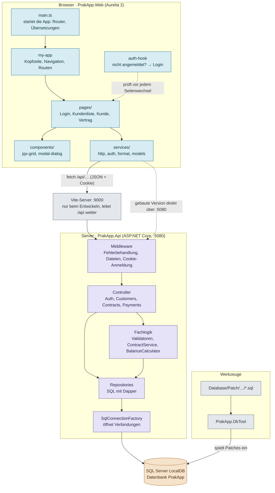
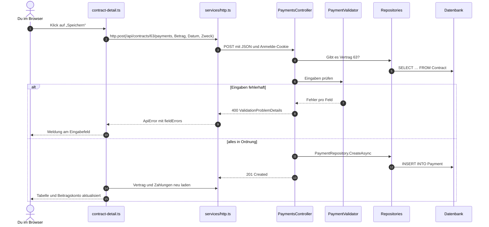
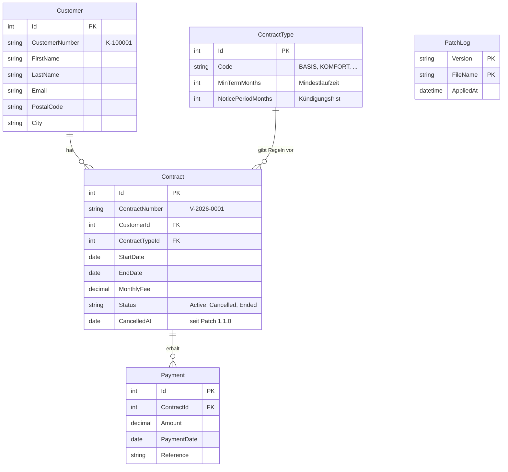

Praktikum · Vertragsverwaltung

# prak-app Architektur

Wie die Teile der App zusammenhängen: vom Klick im Browser über die REST-API bis in die Datenbank. Alles hier stammt direkt aus dem Code (Stand 22.10.2026).

**Inhalt:** [Überblick](#überblick) · [Das große Bild](#das-große-bild) · [Ablauf einer Anfrage](#ablauf-einer-anfrage-zahlung-erfassen) · [Backend](#backend-srcprakappapi) · [Frontend](#frontend-srcprakappweb) · [Datenbank](#datenbank) · [Werkzeuge & Tests](#werkzeuge--tests) · [Begriffe](#begriffe-kurz-erklärt) · [Doku vs. Code](#wo-die-doku-vom-code-abweicht)

## Überblick

Die App verwaltet Kunden, Verträge und Zahlungen der fiktiven „Lindenau Tarifservice GmbH“. Sie besteht aus drei großen Teilen, die über klar getrennte Schnittstellen miteinander reden.

- **Frontend:** Aurelia 2 + TypeScript – läuft im Browser · `src/PrakApp.Web`
- **Backend:** ASP.NET Core (.NET 9) – REST-API · `src/PrakApp.Api`
- **Datenbank:** SQL Server LocalDB – Datenbank `PrakApp`
- **Adressen:** Port 5080 und 9000 – 5080 = Backend, 9000 = Vite beim Entwickeln

## Das große Bild

Jeder Pfeil zeigt, wer wen benutzt. Wichtig ist die Richtung: Ein Controller kennt die Repositories, aber ein Repository weiß nichts von Controllern. So bleibt jede Schicht für sich verständlich und testbar.

Legende: Frontend (Browser) · Backend (Server) · Datenbank · Werkzeuge

*Beim Entwickeln (F5) öffnest du `http://localhost:9000`. Vite liefert dann die Frontend-Dateien und reicht alle `/api`-Aufrufe an das Backend weiter. Nach `pnpm build` liegt das fertige Frontend in `src/PrakApp.Api/wwwroot`, dann liefert das Backend alles selbst über Port 5080 aus.*

## Ablauf einer Anfrage: „Zahlung erfassen“

Am besten versteht man die Schichten, wenn man eine echte Aktion durch das System verfolgt. So läuft es ab, wenn du auf der Vertragsseite eine Zahlung speicherst:

Daran sieht man die Aufgaben der Schichten: Die **Seite** sammelt die Eingaben, **http.ts** verschickt sie, der **Controller** entscheidet über den HTTP-Statuscode, der **Validator** prüft die Regeln und das **Repository** schreibt in die Datenbank. Fehler 400 (falsche Eingabe) landen freundlich am Eingabefeld. Alles, was niemand abfängt, wird zu einem Fehler 500 und erscheint oben als roter Hinweis „Unerwarteter Fehler“.

## Backend: `src/PrakApp.Api`

Die Dateien sind nach **Fachthema** gruppiert, nicht nach Technik. Alles rund um Kunden liegt in `Customers/`, egal ob Controller, Validator oder Repository. Fast jede Fachthemen-Mappe enthält dieselben Bausteine:

| Baustein | Aufgabe | Beispiel |
|---|---|---|
| Controller | nimmt HTTP-Anfragen an, ruft die richtigen Klassen auf, gibt Statuscodes zurück (200, 201, 400, 404, 409) | `CustomersController` |
| Models | `record`-Typen: wie die Daten aussehen (Ein- und Ausgabe) | `CustomerInput`, `Customer` |
| Validator | prüft Eingaben und sammelt Fehlermeldungen pro Feld | `CustomerValidator` |
| Repository | enthält das SQL und übersetzt Tabellenzeilen in C#-Objekte (mit Dapper) | `CustomerRepository` |
| Service | Fachlogik, die mehrere Repositories braucht (gibt es nur bei Verträgen) | `ContractService` |

#### `Program.cs`

Der Startpunkt. Hier wird alles „verdrahtet“: Anmeldung per Cookie, die Middleware-Reihenfolge und die Registrierung aller Klassen für Dependency Injection.

- Die Controller verlangen Anmeldung (`RequireAuthorization`)
- `/health` antwortet ohne Anmeldung
- Unbekannte Adressen → `index.html` (damit Links wie `/customers/12` funktionieren)

#### `Auth/`

Demo-Anmeldung ohne Passwort. Man wählt einen Benutzer aus der Liste in `appsettings.json` und bekommt ein Cookie `prakapp.auth`.

- `AuthController`: users, login, logout, me
- `DemoUser.cs`: Einstellungen für die Benutzerliste

#### `Customers/`

Kunden suchen, anzeigen, anlegen und ändern. Die Kundennummer `K-…` vergibt das SQL beim Anlegen.

- Controller, Models, Validator, Repository
- Pflichtfelder Vor- und Nachname, PLZ fünfstellig, E-Mail-Format

#### `Contracts/`

Verträge, Tarife und das Beitragskonto. Der umfangreichste Bereich, weil hier die meiste Fachlogik steckt.

- `ContractService`: Anlegen, Details, Kündigen
- `BalanceCalculator`: fällige Monate, Soll, Saldo
- Kündigung erst teilweise umgesetzt (TODO)

#### `Payments/`

Zahlungen zu einem Vertrag anzeigen und erfassen. Die Adresse hängt am Vertrag: `/api/contracts/{id}/payments`.

- Controller, Models, Validator, Repository

#### `Common/` · `Data/`

Gemeinsame Helfer. `ValidationErrors` sammelt Fehler pro Feld, `CurrentUser` liest den angemeldeten Benutzernamen. `SqlConnectionFactory` erzeugt Datenbankverbindungen aus dem Connection String.

### Wer lebt wie lange? (Dependency Injection in `Program.cs`)

| Lebensdauer | Bedeutung | Klassen |
|---|---|---|
| `Singleton` | genau ein Objekt für die ganze Laufzeit | `TimeProvider`, `SqlConnectionFactory`, alle Validatoren, `BalanceCalculator` |
| `Scoped` | ein neues Objekt pro HTTP-Anfrage | alle Repositories, `ContractService` |

`TimeProvider` ist ein kleiner Trick für Tests: Statt direkt „jetzt“ abzufragen, fragt der Code den TimeProvider. In einem Test kann man ihm ein festes Datum geben, siehe `BalanceCalculatorTests`.

### Alle Endpunkte (so wie sie im Code stehen)

| Methode | Pfad | Was passiert |
|---|---|---|
| GET | `/api/auth/users` | Liste der Demo-Benutzer (ohne Anmeldung) |
| POST | `/api/auth/login` · `/logout` | Anmelden / Abmelden |
| GET | `/api/auth/me` | Wer ist angemeldet? Sonst 401 |
| GET | `/api/customers?q=…` | Kunden suchen (ohne `q`: alle) |
| GET · PUT | `/api/customers/{id}` | Kunde lesen / ändern |
| POST | `/api/customers` | Kunde anlegen |
| GET | `/api/customers/{id}/contracts` | Verträge eines Kunden |
| GET | `/api/contract-types` | Tarife |
| GET | `/api/contracts/{id}` | Vertrag mit Beitragskonto |
| POST | `/api/contracts` | Vertrag anlegen |
| POST | `/api/contracts/{id}/cancel` | Vertrag kündigen (noch unfertig) |
| GET · POST | `/api/contracts/{id}/payments` | Zahlungen lesen / erfassen |
| GET | `/health` | Lebenszeichen für Start-Skripte und Playwright |

## Frontend: `src/PrakApp.Web`

Eine Single-Page-App: Der Browser lädt einmal `index.html`, danach tauscht Aurelia nur noch den Inhalt aus. Zu jeder `.ts`-Datei (Logik) gehört eine gleichnamige `.html`-Datei (Aussehen). Beide verbindet Aurelia über **Bindings** wie `value.bind` oder `click.trigger`.

#### `src/main.ts`

Startet Aurelia, richtet Router und Übersetzungen ein und meldet globale Bausteine an, die überall ohne Import nutzbar sind (Grid, Dialog, Kundenformular, Auth-Hook).

#### `src/my-app.*`

Der Rahmen um jede Seite: Kopfzeile, Sprachauswahl, Abmelden, roter Fehlerhinweis. Hier stehen auch die **Routen**, also welche Adresse welche Seite zeigt.

- `login`, `customers`, `customers/:id`, `contracts/:id`

#### `src/auth-hook.ts`

Läuft vor jedem Seitenwechsel. Ist niemand angemeldet, geht es zur Anmeldeseite. Nur die Login-Route ist als öffentlich markiert.

#### `src/pages/`

Die Seiten, die man sieht. Jede lädt ihre Daten in `loading()`, bevor sie angezeigt wird.

- `login/`: Benutzer auswählen
- `customers/`: Liste mit Suche, Detailseite, Formular
- `contracts/`: Vertragsdetails, Zahlung erfassen

#### `src/components/`

Dünne Hüllen um jQWidgets, damit man sie wie normale Aurelia-Bausteine benutzen kann.

- `jqx-grid`: Tabelle mit Sortieren und Seiten
- `modal-dialog`: Dialogfenster, Inhalt per `<au-slot>`

#### `src/services/`

Alles ohne eigene Oberfläche.

- `http.ts`: `fetch`-Hülle, macht aus Fehlern ein `ApiError`
- `auth.ts`: hält den angemeldeten Benutzer (Singleton)
- `format.ts`: Geld und Datum formatieren
- `models.ts`: TypeScript-Typen passend zur API

#### `src/jqx/`

Lädt jQuery und die jQWidgets-Module in der richtigen Reihenfolge. jQWidgets erwartet jQuery als globale Variable, deshalb kommt `jquery-global.ts` zuerst.

#### `src/locales/`

Alle Texte der Oberfläche auf Deutsch (`de.json`) und Englisch (`en.json`). Im HTML stehen nur Schlüssel wie `t="customers.title"`.

## Datenbank

Vier Fachtabellen und eine Verwaltungstabelle. Die Linien zeigen die Beziehungen: Ein Kunde kann viele Verträge haben, ein Vertrag viele Zahlungen, und jeder Vertrag gehört zu genau einem Tarif.

*Vereinfacht: Es sind nicht alle Spalten gezeigt. Die vollständigen Definitionen stehen in den Patch-Skripten.*

### Wie das Schema entsteht: Patch-Skripte

Es gibt keine Datei „so sieht die Datenbank aus“. Stattdessen gibt es eine Reihe nummerierter Änderungen unter `Database/Patch/<Version>/Approved/core/`, die nacheinander eingespielt werden:

1. `1.0.0/0001` bis `0004`: Tabellen anlegen
2. `1.0.0/0005`: die vier Tarife eintragen
3. `1.0.0/0006`: erfundene Demo-Daten (64 Kunden, 77 Verträge, rund 1.550 Zahlungen)
4. `1.1.0/0001`: Spalten für die Kündigung ergänzen

Die Tabelle `PatchLog` merkt sich, was schon eingespielt ist. Deshalb gilt: **Ein eingespieltes Skript wird nie mehr geändert.** Jede neue Änderung bekommt ein neues Skript mit der nächsten Nummer.

## Werkzeuge & Tests

#### `tools/PrakApp.DbTool`

Kleines Kommandozeilen-Programm, das die Patch-Skripte einspielt. `rebuild` löscht die Datenbank und baut sie neu auf, `update` spielt nur fehlende Patches ein.

#### `Database/rebuild-database.ps1`

Startet LocalDB und ruft das DbTool mit `rebuild` auf. Auch in VS Code als Aufgabe „db: rebuild“ verfügbar.

#### `tests/PrakApp.Api.Tests`

xUnit-Tests für das Backend, Start mit `dotnet test`.

- Unit-Tests: Validatoren, `BalanceCalculator`
- Integrationstests: Anmeldung, startet die API im Speicher ohne Datenbank

#### `src/PrakApp.Web/e2e`

Playwright-Tests: Ein echter Browser klickt sich durch die App (Anmeldung, Kunden anlegen und öffnen). Braucht die gebaute App und die Datenbank.

#### `.vscode/`

F5 startet Backend (mit Debugger) und Vite zusammen. Weitere Aufgaben unter Terminal → Aufgabe ausführen: Tests, Frontend bauen, Datenbank neu aufbauen.

#### `sample-logs/`

Beispiel-Logdateien für Übungen zur Fehlersuche. Zeitstempel in UTC, Aufbau erklärt im Handbuch, Kapitel 4.

## Begriffe kurz erklärt

- **REST-API:** Eine Schnittstelle über HTTP: Das Frontend schickt Anfragen an Adressen wie `/api/customers` und bekommt JSON zurück.
- **Controller:** Die Klasse, die eine Anfrage entgegennimmt und entscheidet, was zurückkommt (Daten oder Fehlercode).
- **Repository:** Die einzige Stelle, die mit der Datenbank spricht. Der Rest des Codes ruft nur Methoden wie `GetAsync(id)` auf und kennt kein SQL.
- **Dapper:** Kleine Bibliothek, die SQL ausführt und die Ergebnisse automatisch in C#-Objekte umwandelt.
- **Dependency Injection:** Klassen erzeugen ihre Helfer nicht selbst, sondern bekommen sie über den Konstruktor geliefert. Wer was bekommt, steht in `Program.cs`. Vorteil: In Tests kann man Helfer austauschen.
- **Middleware:** Stationen, durch die jede Anfrage der Reihe nach läuft, bevor sie den Controller erreicht, z. B. Fehlerbehandlung und Anmeldung.
- **Binding:** Aurelia verbindet ein Feld im HTML mit einer Variablen in der `.ts`-Datei. Ändert sich das eine, ändert sich das andere mit.
- **Route:** Die Zuordnung „diese Adresse zeigt diese Seite“, z. B. `customers/:id` → Kundendetails.
- **Proxy:** Ein Vermittler: Vite nimmt `/api`-Aufrufe auf Port 9000 an und reicht sie an das Backend auf Port 5080 weiter.
- **Patch-Skript:** Eine SQL-Datei, die die Datenbank um genau einen Schritt verändert. Alle Patches nacheinander ergeben das aktuelle Schema.

## Wo die Doku vom Code abweicht

Laut `CLAUDE.md` gilt im Zweifel der Code. Beim Vergleich mit `docs/` sind diese Unterschiede aufgefallen:

**docs/api.md**

- Suchparameter heißt im Code `q`, nicht `search`.
- Zahlungen laufen über `/api/contracts/{id}/payments`, nicht über `/api/payments?contractId=…`.
- Einen Endpunkt zum Löschen von Kunden (`DELETE`) gibt es nicht.
- Die Regel „Zahlungsdatum nicht in der Zukunft“ wird im Code nicht geprüft.

**docs/architektur.md**

- Die Sitzung läuft laut Doku nach 30 Minuten ab, im Code (`Program.cs`) nach 8 Stunden ohne Aktivität.
- Laut Doku findet die Suche auch nach Ort, das SQL in `CustomerRepository` durchsucht aber nur Name und Kundennummer.

Ob jeweils die Doku oder der Code angepasst werden sollte, ist eine fachliche Entscheidung, die man mit dem Betreuer klären sollte.

---

Erstellt mit Claude Code durch Lesen des Quellcodes von prak-app (Commit e5e3c79 plus lokale Änderungen). Diagramme vereinfacht.
